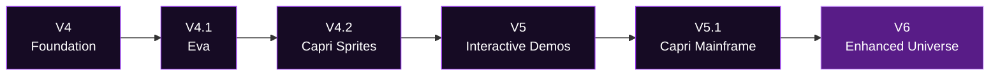

 <div align="center">

# 🌌 ZYREN AI UNIVERSE

### `Where Artificial Intelligence Comes Alive`


**Un univers numérique dédié aux assistants IA, aux compagnons virtuels et aux expériences interactives.**


</div>

---

## ✦ Explore the Universe

<table>
<tr>
<td width="33%" align="center">

### 💜 EVA

**Windows AI Assistant**

Assistante virtuelle vocale destinée à Windows.

`Voice Commands` · `Automation` · `C#`

</td>
<td width="33%" align="center">

### 🌸 CAPRI

**Desktop Companion**

Compagnon animé et interactif sur le bureau.

`Pixel Art` · `Animations` · `AI`

</td>
<td width="33%" align="center">

### 🤖 EVA DISCORD

**Community Assistant**

Projet de bot communautaire pour Discord.

`Slash Commands` · `Moderation` · `Bot`

</td>
</tr>
</table>

---

## ⚡ Interactive Experiences

<details>
<summary><b>💜 EVA — Windows AI Assistant</b></summary>

### Voice-Controlled Desktop

Eva est un projet d'assistante virtuelle permettant d'explorer les interactions entre la voix, les applications Windows et l'intelligence artificielle.

**Démonstration web :**

- Bureau Windows fictif et interactif.
- Fenêtres et applications simulées.
- Historique des commandes.
- Reconnaissance vocale via le navigateur compatible.
- Réactions et animations de l'interface.

> La démonstration ne contrôle pas directement Windows.

</details>

<details>
<summary><b>🌸 CAPRI — Desktop Companion</b></summary>

### Your Animated AI Companion

Une expérience interactive mettant en scène Capri et ses différentes expressions.

**Fonctionnalités présentées :**

- Déplacements animés.
- Changements d'humeur.
- Interactions à la souris.
- Animations de danse et de repos.
- Menu contextuel.
- Mainframe et paramètres simulés.

> Capri est un projet tiers. La démonstration web n'est pas connectée au logiciel installé.

**Site officiel :** https://capriai.app/

</details>

<details>
<summary><b>🤖 EVA DISCORD — Community AI</b></summary>

### Intelligent Community Experience

Une interface inspirée de Discord pour découvrir les fonctionnalités envisagées du bot Eva.

**Démonstration :**

- Salons et conversations fictifs.
- Commandes slash.
- Suggestions de commandes.
- Messages enrichis.
- Outils de modération simulés.
- Réponses interactives.

> Aucun serveur Discord réel n'est connecté.

</details>

---

## 🛠️ Tech Stack

<div align="center">


</div>

Le site est développé en **HTML, CSS et JavaScript**, sans framework obligatoire ni backend.

Les projets présentés peuvent utiliser d'autres technologies indépendamment du site.

---

## 🚀 Run Locally

```bash
git clone https://github.com/TON_PSEUDO/ZyrenAI.git
cd ZyrenAI
python -m http.server 8000
```

Ouvre ensuite :

`http://localhost:8000/`

Tu peux également utiliser **Live Server** dans VS Code.

---

## 📂 Project Structure

```text
ZyrenAI/
├── index.html
├── eva.html
├── capri.html
├── discord.html
├── css/
├── js/
├── assets/
│   ├── capri/
│   └── videos/
└── README.md
```

---

## 🧬 Development Timeline



---

## 🌐 Live Website

<div align="center">

[](https://TON_PSEUDO.github.io/ZyrenAI/)

</div>

> Remplace `TON_PSEUDO` par ton identifiant GitHub et active GitHub Pages pour rendre le site accessible.

---

## 🔒 Privacy & Credits

Les démonstrations du site sont des simulations fonctionnant dans le navigateur. Elles ne donnent pas accès au système Windows, à un compte Discord ou à une instance Capri réelle.

Capri et Discord sont des projets ou plateformes tiers. Aucune affiliation officielle n'est revendiquée. Les ressources graphiques tierces restent soumises à leurs licences respectives.

Ne publie aucune clé API, aucun jeton ou identifiant privé dans le dépôt.

---

<div align="center">

### 💜 Created by Zyren

*AI • Creativity • Technology*


</div>